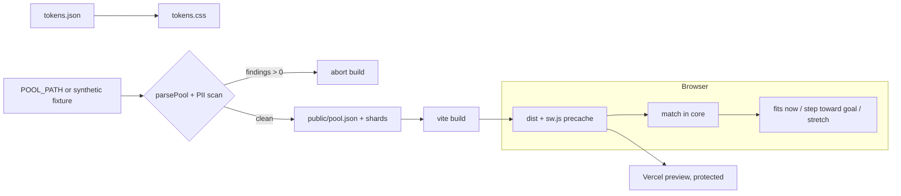
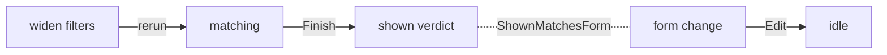

# kanithanj.ai web (v0)

| command | does |
|---|---|
| `npm run build` | tokens, pool scan, typecheck, build |
| `POOL_PATH=… npm run build` | same with a local pool, never committed |
| `npx playwright test` | 0 requests carry the description, trap states, offline, 30 abuse inputs, axe |
| `STAGE_DIR=… bash scripts/stage-deploy.sh` | build, rescan the bundled pool, write a deploy manifest |

## What the checks prove

- `spec/tla/WebTraps.tla` models every form field (description, goal, regions, work mode, product companies only) as one `Edit` step that clears the shown verdict, and widening (any region, any work mode, include agencies) as an immediate rerun. The product filter adds no new state, so the statechart is unchanged. TLC checks `ShownMatchesForm`: a shown verdict always belongs to the current form. `check/contract.test.ts` fails if the `View` kinds in `App.tsx` drift from the spec's `Ready` set or if a field stops resetting the view.
- `NoDescriptionInRequests` in the spec only restates that the model has no request carrying text. The privacy claim rests on the Playwright test that records every request and finds 0 carrying the description or goal.
- `check/contract.test.ts` also pins the CSP and security headers in `vercel.json` and checks the built page has no inline script, style or handler the CSP would block.
