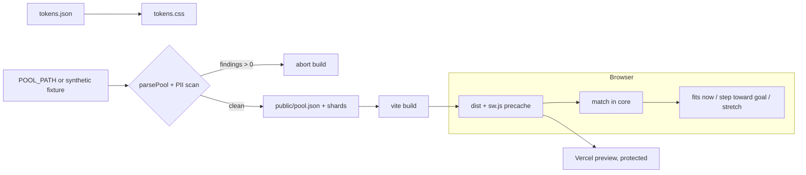

# kanithanj.ai web (v0)

| command | does |
|---|---|
| `npm run build` | tokens, pool scan, typecheck, build |
| `POOL_PATH=… npm run build` | same with a local pool, never committed |
| `npx playwright test` | 0 requests carry the description, trap states, offline, 30 abuse inputs, axe |
| `STAGE_DIR=… bash scripts/stage-deploy.sh` | build, rescan the bundled pool, write a deploy manifest |
