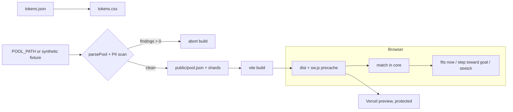
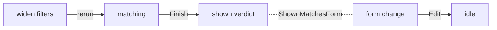

# kanithanj.ai web (v0)

| command | does |
|---|---|
| `npm run build` | tokens, pool scan, typecheck, build |
| `POOL_PATH=… npm run build` | same with a local pool, never committed |
| `npx playwright test` | 0 requests carry the description, trap states, offline, 30 abuse inputs, axe |
| `STAGE_DIR=… bash scripts/stage-deploy.sh` | build, rescan the bundled pool, write a deploy manifest |

## What the checks prove

- `spec/tla/WebTraps.tla` models every form field (description, goal, companies or interests you like, regions, work mode, product companies only) as one `Edit` step that clears the shown verdict, and widening (any region, any work mode, include agencies) as an immediate rerun. The likes box is its own variable: personal details in it stop the match like in the description, and `LikesOnlyReorder` checks it never changes which verdict is shown. TLC checks `ShownMatchesForm`: a shown verdict always belongs to the current form, likes included. `check/contract.test.ts` fails if the `View` kinds in `App.tsx` drift from the spec's `Ready` set or if a field stops resetting the view.
- `NoDescriptionInRequests` in the spec only restates that the model has no request carrying text. The privacy claim rests on the Playwright test that records every request and finds 0 carrying the description or goal.
- `check/contract.test.ts` also pins the CSP and security headers in `vercel.json` and checks the built page has no inline script, style or handler the CSP would block.

## How results are ordered

- Each group is ordered by certainty tier first (place confirmed and level fits, then one level up or unknown status, then place not confirmed), then by the shown score, which is rounded down to a 5-point bucket so it explains the order. A company named in the likes box adds a fixed 15 points, once, and changes no group. Inside a bucket, a title that names one of the profile's skills comes first (never a title listing two or more skills), then a title naming more of the profile's role focus (frontend, backend, ML, infrastructure and similar, counted up to two). Remaining ties break on lexical relevance: BM25 between the description plus goal tokens and each row's title plus role tags, after a small stop-word and synonym table. Each distinct profile token counts once per row, and titles that are mostly a skill list are damped. The query drops place words (countries, cities, `us`, `uk`), because places count only through the place boost, and reads Go as the language `golang` on both sides when it is capitalized (except a sentence-opening verb such as "Go further"), in a skills context ("years of go", "python and go", "go developer") or a title token such as "(Go)" or "- Go". Lowercase verb uses stay filler. Some synonyms are lossy on purpose: `sql` maps to `postgres`, so MySQL and SQL Server profiles get Postgres matches; `ui` and `ux` map to `frontend`; `react native` maps to `react mobile`. Corpus statistics are computed inside the core once per loaded pool object and cannot be passed in from outside, so a match on the real pool takes under 150 ms in the browser.
- A role one level above yours loses a fixed step of relevance. A city or country you name adds a small boost.
- Rows collapse into one, across all groups and kept in the best group, only when the title differs by location parts alone, such as `, Rome`, ` - Berlin`, `(London)` or `| Sweden | Remote`.
- Mobile-titled rows for a profile without mobile terms stay in stretch, never in its top 10 while other stretch rows remain. Rows with no other overlap sit at the bottom.
- The goal signals `frontier AI labs` and `product teams` are understood but match titles only, and few titles name them (9 and 1 in the v0 pool). They become company-level signals in v1.

## Page tools (WebMCP)

The official `@w3c/webmcp-polyfill` is loaded in `src/main.tsx` so `document.modelContext` exists in a secure browser. The current form is annotated with `toolname="find_roles"` (no `toolautosubmit`). The same page also registers `find_roles`, `tailor_cv` and `show_apply_pack` through `registerTool`, because the polyfill does not yet implement declarative forms. All three stay in the tab and are read-only: they do not apply or send. If a call asks to apply or send, a person must confirm in the page, and the page still does not apply or send. Rebuilding the live surfaces with UI SDK components is a later step.
