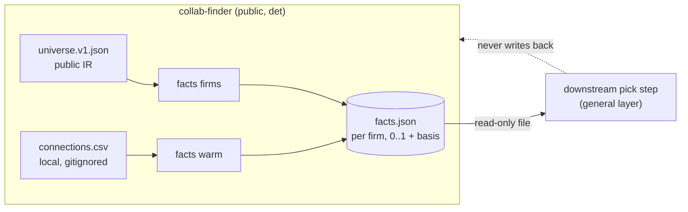
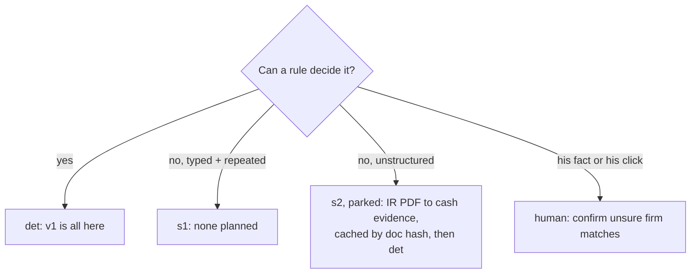
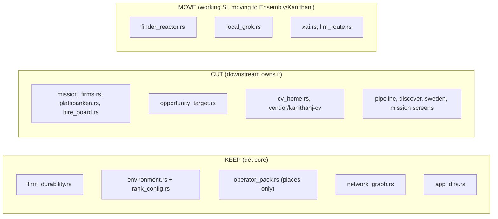
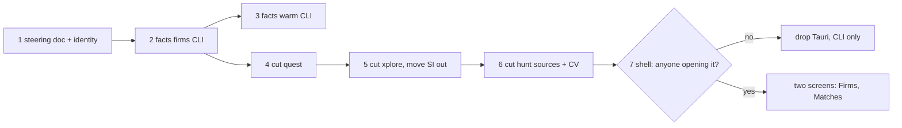

# Steering: collab-finder as a facts feeder

collab-finder stops being a second job-hunt app. It becomes a small, deterministic tool that answers two questions about firms and hands the answers to the pick step downstream:

1. **Is this firm stable?** Public IR cash evidence, already in `data/durability/universe.v1.json`.
2. **Do I know someone there?** Local connection exports, already parsed by `network_graph.rs`.

Finding, ranking, packing, applying and follow-ups belong to the downstream app. collab-finder does none of them.

## The one contract

`facts.json` uses the general-layer shape: keyed by firm id, each value `{value 0..1, basis}`, and a missing value means unknown. collab-finder never guesses a value.

| Sub-input | From | Rule (det) |
|---|---|---|
| `comp_stability.funding_runway` | `fortress` (0..4) + `cash` | `fortress / 4`; basis = `fy` + IR source URL |
| `culture.layoff_history` | `note` / cash trend | parked until there is a sourced field |
| `hire_likelihood.referral_or_warm_intro` | connections by company | ex-colleague ⇒ 1.0, first-degree ⇒ 0.6, no match ⇒ unknown |
| `red_flags` (soft) | `hiring_signal == 0`, `theater_saas` | soft flag with reason; never `hard` |

Warm-path output holds **counts per firm only**. No names, emails or profiles ever leave collab-finder.

## Lanes

v1 makes no SI calls. `xai.rs`, `llm_route.rs`, `local_grok.rs` and `finder_reactor.rs` work (their tests pass and the xAI path answers live), but SI belongs in Ensembly and Kanithanj (private). They move there and leave collab-finder, rather than staying as fallbacks.

## Keep / cut

The PR #101 marker list is reused as the delete order. Items are deleted one slice at a time, with no `#[deprecated]` step in between.

## Order

Each slice is one PR. Each slice is green on `pnpm gate` and `cargo test`. A cut PR deletes the code, its tests and its IPC commands together.

## Out of scope

- Any change to the downstream app. Merging several facts files there is its own task.
- Real data in git. Fixtures stay synthetic: `data/*.sample.csv`, the example universe.
