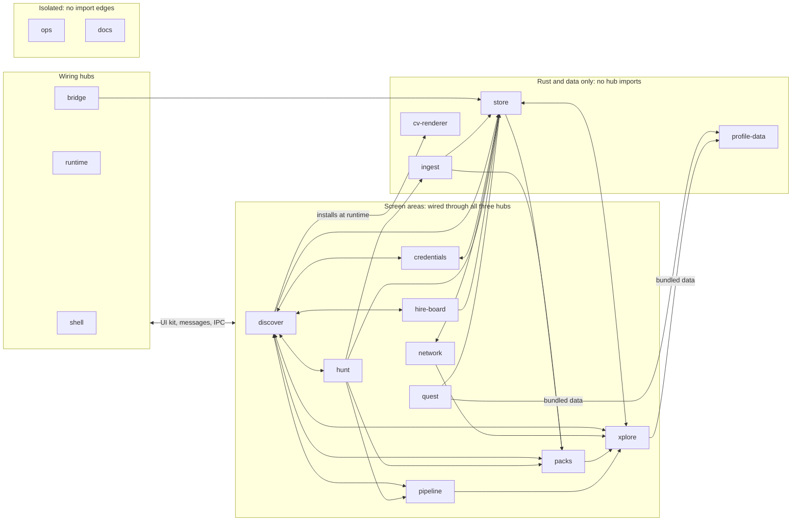

# Areas

Every tracked file belongs to one area. Tests and `*.verify.mjs` runners sit with the area they cover.

An arrow means depends on. Edges were read from TS imports, Rust paths, and IPC names on main at `0ea82a9`. The hub edge folds 56 links (UI kit, messages, IPC). The other 34 are drawn. `<-->` is a two-way pair.

Sixteen areas share one tree. `discover` has 11 neighbours. `store` is the data area the most others depend on. Cycles run through `discover` and `store`. `profile-data` and `cv-renderer` only have incoming edges. `ops` and `docs` have none. `ops` still chooses which checks run.

`*` stays inside one path segment. `**` walks directories. `docs/ops/areas.json` is the config the check reads.

## Paths

| Area | Kind | Owns |
|---|---|---|
| shell | functional | `src/main.tsx`, `src/App.tsx`, `src/vite-env.d.ts`, `src/app/**`, `src/shell/**`, `src/lib/**`, `src/index.css`, `src/types/**`, `src/view/finder-app-view.tsx`, `src/view/screens/heading-screen.tsx`, `src/components/layout/**`, `src/components/ui/**`, `src/components/finder/command-palette.tsx`, `src/components/finder/error-banner.tsx`, `src/core/domain/finder-nav*`, `src/core/domain/finder-keyboard*`, `src/core/domain/heading-*`, `index.html` |
| runtime | functional | `src/core/finder/**`, `src/core/mvu/**`, `src/runtime/**`, `src/ports/finder-port.ts`, `src/core/async.ts`, `src/core/result.ts`, `src/core/error.ts` |
| bridge | functional | `src/adapters/tauri/**` except `src/adapters/tauri/credentials-adapter.ts`, `src-tauri/src/lib.rs`, `src-tauri/src/main.rs`, `src-tauri/src/commands/mod.rs`, `src-tauri/capabilities/**`, `src-tauri/tauri.conf.json`, `src-tauri/build.rs` |
| discover | functional | `src-tauri/src/opportunity_target.rs`, `src-tauri/src/cv_home.rs`, `src-tauri/src/xai.rs`, `src-tauri/src/llm_route.rs`, `src/core/domain/application-pack.ts`, `src/core/domain/cv-*`, `src/core/domain/discover-*`, `src/core/domain/devprofile-path-panel*`, `src/core/domain/fit-*`, `src/core/domain/llm-route*`, `src/core/domain/opportunity-rail-label*`, `src/core/domain/opportunity-target*`, `src/core/domain/opportunity-url*`, `src/core/domain/fixtures/**`, `src/components/finder/opportunity-target-fit-panel.tsx`, `src/components/finder/artifact-reader.tsx`, `src/components/finder/cv-*`, `src/view/screens/discover-screen.tsx`, `scripts/fit-calibration.mjs` |
| hunt | functional | `src-tauri/src/platsbanken.rs`, `src-tauri/src/mission_firms.rs`, `src-tauri/src/america_eu.rs`, `src-tauri/src/product_lane.rs`, `src-tauri/src/commands/hunt.rs`, `src-tauri/tests/**`, `src/core/domain/hunt-rails*`, `src/core/domain/platsbanken*`, `src/core/domain/mission-*`, `src/core/domain/sweden-hunt*`, `src/components/finder/hunt-*`, `src/view/screens/sweden-screen.tsx`, `src/view/screens/mission-screen.tsx`, `data/hunt-presets/**`, `data/mission-firms/**`, `scripts/generate-firm-list.mjs`, `scripts/qa-platsbanken-freshness.sh`, `docs/qa/**` |
| xplore | functional | `src-tauri/src/finder_reactor.rs`, `src-tauri/src/x_search.rs`, `src-tauri/src/x_query.rs`, `src/core/domain/finder.ts`, `src/core/domain/distillation.ts`, `src/core/domain/search-presets.ts`, `src/components/finder/search-workspace.tsx`, `src/components/finder/tweet-feed.tsx`, `src/components/finder/decision-panel.tsx`, `src/components/finder/pause-log.tsx`, `src/view/screens/xplore-screen.tsx`, `data/distillation/x-search/**` |
| pipeline | functional | `src-tauri/src/qualify_policy.rs`, `src/core/domain/history.ts`, `src/core/domain/pipeline-timeline.ts`, `src/core/domain/opportunity-pipeline*`, `src/core/domain/apply-reply-lane*`, `src/core/domain/qualify-policy*`, `src/view/screens/pipeline-screen.tsx`, `scripts/export-pipeline.mjs`, `scripts/sync-pack-artifacts.py`, `scripts/qualify-hillclimb.mjs` |
| quest | functional | `src-tauri/src/local_grok.rs`, `src/core/domain/quest*`, `src/components/finder/quest-drawer.tsx` |
| credentials | functional | `src-tauri/src/secrets.rs`, `src-tauri/src/secrets/**`, `src/core/domain/credentials.ts`, `src/core/domain/xai-key-*`, `src/core/security/**`, `src/ports/credentials-port.ts`, `src/adapters/tauri/credentials-adapter.ts`, `src/components/finder/credentials-*`, `src/view/screens/settings-screen.tsx` |
| cv-renderer | functional | `vendor/kanithanj-cv/**`, `scripts/install-kanithanj-cv.sh`, `scripts/pull-cv-renderer.sh`, `scripts/pull-cvdata.sh`, `scripts/test-cv-sot.sh`, `scripts/test-pull-*` |
| store | data | `src-tauri/src/db.rs`, `src-tauri/src/app_dirs.rs`, `src-tauri/src/pulse.rs`, `scripts/backup-db.sh`, `scripts/pulse-export.mjs`, `scripts/pulse-import.mjs`, `scripts/seed-testdata-for-ci.sh` |
| packs | data | `src-tauri/src/operator_pack.rs`, `src-tauri/src/rank_config.rs`, `src-tauri/src/environment.rs`, `src-tauri/src/firm_durability.rs`, `src/core/domain/operator-pack-health.ts`, `src/core/domain/firm-durability.ts`, `src/core/domain/firm-maintained-list*`, `src/view/screens/preferences-*`, `data/durability/**`, `data/pipeline/**`, `scripts/seed-operator-config.sh`, `scripts/load-pipeline-config.mjs` |
| ingest | data | `src-tauri/src/research_ingest.rs`, `src-tauri/src/bin/**`, `src-tauri/fixtures/**` |
| network | data | `src-tauri/src/network_graph.rs`, `src/core/domain/network-graph.ts`, `src/view/screens/network-screen.tsx`, `data/connections.sample.csv`, `data/contacts.sample.csv`, `data/network-csv.md` |
| hire-board | data | `src-tauri/src/hire_board.rs`, `src/core/domain/hire-board.ts`, `src/components/finder/hire-board-panel.tsx`, `data/hire-board/**` |
| profile-data | data | `data/distillation/**` except `data/distillation/x-search/**`, `scripts/prune-public-projects.mjs` |
| ops | ops | `.github/**`, `scripts/ci-*`, `scripts/run-verify.mjs`, `scripts/cut-release.sh`, `scripts/ensure-lizard.sh`, `scripts/sync-agent-skills.sh`, `scripts/gate.sh`, `scripts/area-map*`, `dx/**`, `package.json`, `pnpm-lock.yaml`, `src-tauri/Cargo.*`, `src-tauri/icons/**`, `tsconfig.json`, `tsconfig.node.json`, `vite.config.ts`, `postcss.config.js`, `stryker.config.json`, `.gitignore`, `src-tauri/.gitignore`, `session-sot.example`, `skills-lock.json` |
| docs | docs | `**/*.md`, `docs/**`, `.agents/**`, `.grok/**`, `archive/**`, except `docs/qa/**`, `data/**`, `vendor/**`, `.github/**` |

## Cadence

In order:

1. **Nightly** when the area has 1,500+ lines in 30 days, or 10+ neighbours, or it owns the database or the sync path.
2. **Monthly** when it has no import edges and no effect on the build, or it is a quiet leaf: under 200 lines in 30 days, under 1,000 in 90, and at most 5 neighbours.
3. **Weekly** otherwise.

Lines are added plus deleted on main from 2026-09-07 (30 days) and 2026-07-09 (90 days). Lockfiles and binaries are left out. A commit counts once for each area it touches. Edges are distinct neighbours on the graph above.

| Area | Kind | 30 days: commits / lines | 90 days: commits / lines | Edges in / out (neighbours) | Cadence | Reason |
|---|---|---|---|---|---|---|
| shell | functional | 10 / 4,245 | 25 / 5,307 | 11 / 10 (11) | Nightly | Highest code churn; every screen mounts through it |
| hunt | functional | 6 / 3,094 | 28 / 8,765 | 4 / 8 (8) | Nightly | High churn; two hunt screens and the Platsbanken source |
| pipeline | functional | 5 / 2,356 | 8 / 3,057 | 5 / 5 (6) | Nightly | High churn; writes outcomes and the qualify policy |
| discover | functional | 10 / 1,676 | 38 / 12,319 | 9 / 11 (11) | Nightly | Most-changed area over 90 days; writes prep artifacts; calls the SI provider |
| runtime | functional | 6 / 124 | 37 / 3,289 | 11 / 11 (11) | Nightly | Hub: every message and effect passes through it |
| bridge | functional | 6 / 159 | 35 / 2,397 | 7 / 12 (12) | Nightly | Hub: all 75 IPC commands and the capabilities file |
| store | data | 3 / 796 | 13 / 2,099 | 9 / 4 (10) | Nightly | Owns the schema, migrations and the snapshot path |
| credentials | functional | 2 / 1,054 | 14 / 2,594 | 5 / 5 (5) | Weekly | Medium churn; holds secrets (immediate-fix rules apply any day) |
| packs | data | 1 / 111 | 17 / 4,700 | 7 / 5 (8) | Weekly | Quiet now, heavy over 90 days; 8 neighbours |
| xplore | functional | 2 / 95 | 11 / 678 | 8 / 5 (9) | Weekly | Low churn, 9 neighbours |
| network | data | 2 / 49 | 5 / 2,336 | 4 / 4 (5) | Weekly | Over 1,000 lines in 90 days; holds contact data |
| quest | functional | 0 / 0 | 7 / 1,405 | 3 / 4 (5) | Weekly | Over 1,000 lines in 90 days |
| ingest | data | 1 / 779 | 1 / 779 | 1 / 2 (3) | Weekly | New in the 30-day window |
| cv-renderer | functional | 3 / 989 | 12 / 5,318 | 1 / 0 (1) | Weekly | Leaf, but 989 lines in 30 days |
| ops | ops | 8 / 307 | 30 / 1,584 | 0 / 0 (0) | Weekly | No import edges, but sets which checks run for every area |
| hire-board | data | 0 / 0 | 3 / 952 | 3 / 4 (5) | Monthly | Quiet: under 1,000 lines in 90 days |
| profile-data | data | 1 / 1 | 6 / 605 | 2 / 0 (2) | Monthly | Quiet leaf; a change pulls in quest and xplore through the link walk |
| docs | docs | 21 / 8,997 | 71 / 18,845 | 0 / 0 (0) | Monthly | No runtime edges; a code review that finds a stale doc logs it |

7 nightly, 8 weekly, 3 monthly.

## Schedule (UTC)

| When | What |
|---|---|
| About 01:00 daily | laptop-1 writes the encrypted database snapshot; box runs the merge as a dry run and applies only if clean. The timer follows laptop-1 local time, so in winter this moves to about 02:00 UTC. |
| 02:30 daily | Nightly area review. The data part reads the snapshot receipt first; a missing receipt is itself a finding. |
| Monday 03:30 | Weekly area review |
| 1st of the month 04:30 | Monthly area review, then recompute the churn table and area map from a fresh 30 / 90-day window and let the cadence follow |

## Acceptance

- [ ] TODO: script that rebuilds the area graph (TS imports, Rust module paths, IPC command names) and the churn table, with its output committed
