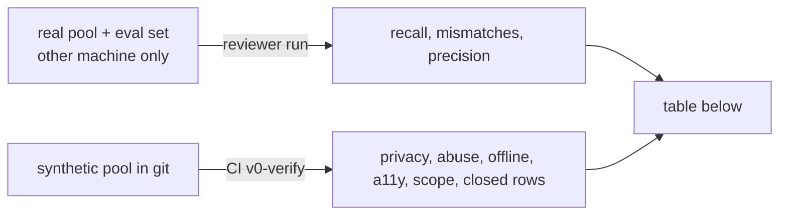
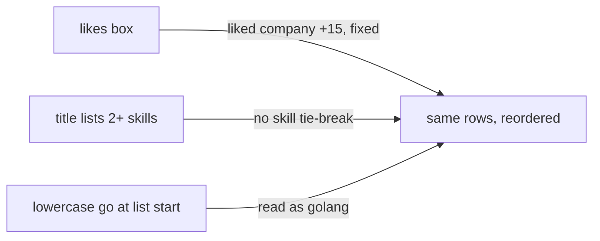

# v0 eval report

The eval set and the real pool never enter git or CI. Real-pool rows are filled from the reviewer's run at the named commit; every other row is checked in CI on each push.

| §5 check | v0 exit | Measured | Where |
|---|---|---|---|
| His description vs his in-pool applied roles, recall@30 | 8 of 11 in the top 30 | pending reviewer run | real pool |
| Known mismatches in fits now | 0 | pending reviewer run | real pool |
| 8 in-scope personas, precision@5 of fits now | ≥ 0.7 mean | pending reviewer run | real pool |
| 3 out-of-scope personas get the honest message | 3 of 3 | 3 of 3 | `core.test.ts` out of scope |
| Closed rows shown | 0 | 0 under 400 generated pools | `properties.test.ts` P1, P13 |
| Requests carrying description, goal or likes | 0 | 0 of 4 (`REQUESTS total=4 carrying_description=0`) | `web.spec.ts` |
| Personal keys in pool export | 0 | 0 | `export.test.ts`, build pool scan |
| Lighthouse accessibility | ≥ 95 | 100 (`LIGHTHOUSE a11y=100`) | v0-verify web job |
| axe WCAG 2.1 A/AA on results and trap states | 0 | 0 (`AXE violations=0`) | `web.spec.ts` |
| Works offline after first load | yes | yes | `web.spec.ts` offline |
| 30 abuse inputs, also in the likes box | 0 errors | 0 (`ABUSE inputs=30 errors=0`) | `web.spec.ts` |
| Form states (TLA+ `WebTraps`, likes included) | no error | 174 distinct states, no error | v0-verify tla job |

Synthetic rows measured at `baeaad1`, CI run 44815136672: core 96/96 tests, web 7/7 Playwright, tla pass.

## Recall changes in this round

- The likes box never adds, drops or regroups a row (property L2); a liked company's score rises by exactly 15 and no row passes it (L3).
- The likes text stays in the tab: no storage API, one fetch for the pool (contract test), 0 requests carry it (Playwright).
