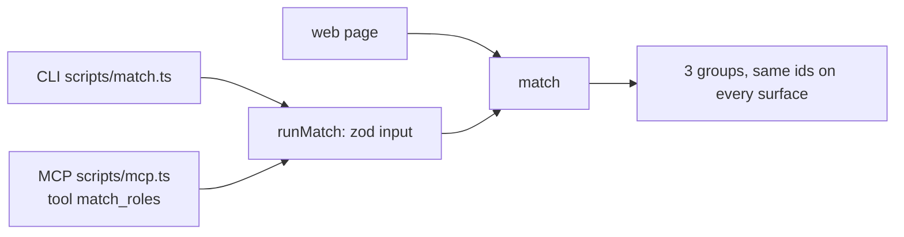
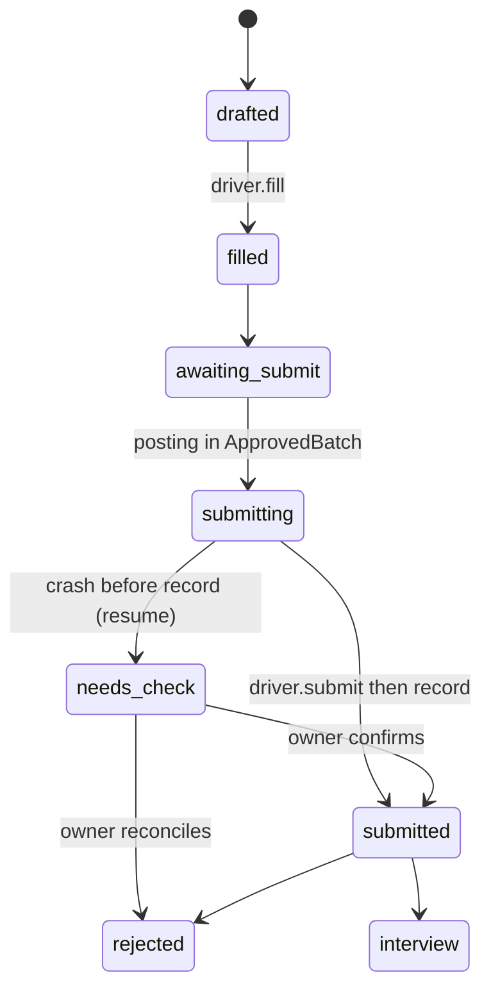

# @kanithanj/core (v1)

Owner approvals are a JSON file outside the git work tree (`KANITHANJ_APPROVALS` or config `approvalPath`). The file lists posting ids; a posting that is not in that record is not approved.

| command | does |
|---|---|
| `node scripts/match.ts --description "…" [--goal …] [--likes …] [--region SE,EU] [--pool path]` | match from flags, JSON out |
| `echo '{"description":"…"}' \| node scripts/match.ts` | match from stdin |
| `KANITHANJ_POOL=path node scripts/mcp.ts` | MCP stdio server, one read-only tool `match_roles` |

MCP client entry: `{"command": "node", "args": ["<repo>/packages/core/scripts/mcp.ts"], "env": {"KANITHANJ_POOL": "<local pool path>"}}`.

| check | where |
|---|---|
| core = CLI = MCP on golden inputs | `test/surfaces.test.ts` |
| page ids = core ids on golden inputs | `apps/web/tests/web.spec.ts` |
| crash anywhere, resume: 0 duplicate entries, ≤ 1 submit, only approved | `test/ledger.test.ts`, `spec/tla/ApplyLedger.tla` |
| posting id = `source:ATS id`, never the URL | `test/spine.test.ts` |
